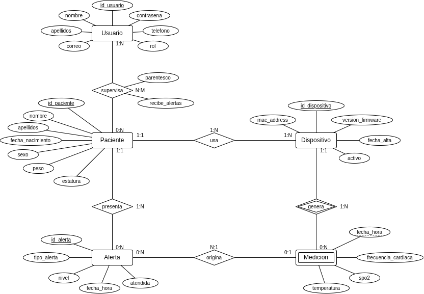

# KORA — Base de datos

Implementación de Internet de las Cosas · TC1004B.501 · Equipo 10 · Yamel Parra Rodriguez (A01798985) y Didier Alejandro Luna Contreras (A01804651)

KORA guarda sus datos en MariaDB, en seis tablas: usuarios, pacientes, supervisión, dispositivos, mediciones y alertas.

## Diagrama ER

Un paciente usa uno o más relojes, cada reloj genera mediciones y un paciente puede tener varios usuarios que lo supervisan. Las alertas se ligan al paciente y, si vienen de una lectura, a la medición que las originó.

## Modelo relacional

Llaves primarias en negritas, llaves foráneas en cursiva.

- Usuario(**id_usuario**, nombre, apellidos, correo, contrasena_hash, telefono, rol)
- Paciente(**id_paciente**, nombre, apellidos, fecha_nacimiento, sexo, peso, estatura)
- Supervisa(***id_usuario***, ***id_paciente***, parentesco, recibe_alertas)
- Dispositivo(**id_dispositivo**, mac_address, version_firmware, fecha_alta, activo, *id_paciente*)
- Medicion(***id_dispositivo***, **fecha_hora**, frecuencia_cardiaca, spo2, temperatura)
- Alerta(**id_alerta**, tipo_alerta, nivel, fecha_hora, atendida, *id_paciente*, *id_dispositivo_med*, *fecha_hora_med*)

Medicion es una entidad débil: se identifica por el dispositivo que la envió y su fecha y hora. Supervisa resuelve la relación N:M entre Usuario y Paciente. En Alerta, la llave hacia Medicion acepta nulos, porque las alertas por caída no vienen de una medición.

## Diccionario de datos

PK = llave primaria, FK = llave foránea. Los campos de sí/no usan 1 y 0.

### Usuario

| Campo | Tipo | Nulo | Llave | Descripción |
| --- | --- | --- | --- | --- |
| id_usuario | INT(11) | No | PK, auto_increment | Identificador del usuario |
| nombre | VARCHAR(50) | No | | Nombre(s) |
| apellidos | VARCHAR(80) | No | | Apellidos |
| correo | VARCHAR(100) | No | Único | Correo para iniciar sesión |
| contrasena_hash | VARCHAR(255) | No | | Contraseña cifrada, nunca en texto plano |
| telefono | VARCHAR(15) | Sí | | Teléfono de contacto |
| rol | ENUM(familiar, medico, admin) | No | | Tipo de usuario del dashboard |

### Paciente

| Campo | Tipo | Nulo | Llave | Descripción |
| --- | --- | --- | --- | --- |
| id_paciente | INT(11) | No | PK, auto_increment | Identificador del paciente |
| nombre | VARCHAR(50) | No | | Nombre(s) |
| apellidos | VARCHAR(80) | No | | Apellidos |
| fecha_nacimiento | DATE | No | | Fecha de nacimiento |
| sexo | ENUM(M, F, O) | No | | Sexo del paciente |
| peso | DECIMAL(5,2) | Sí | | Peso en kg |
| estatura | DECIMAL(3,2) | Sí | | Estatura en metros |

### Supervisa

| Campo | Tipo | Nulo | Llave | Descripción |
| --- | --- | --- | --- | --- |
| id_usuario | INT(11) | No | PK, FK → Usuario | Usuario que supervisa |
| id_paciente | INT(11) | No | PK, FK → Paciente | Paciente supervisado |
| parentesco | VARCHAR(30) | No | | Relación con el paciente (hija, médico tratante…) |
| recibe_alertas | INT(1) | No | | 1 = recibe alertas (por defecto 1) |

### Dispositivo

| Campo | Tipo | Nulo | Llave | Descripción |
| --- | --- | --- | --- | --- |
| id_dispositivo | INT(11) | No | PK, auto_increment | Identificador del reloj |
| mac_address | VARCHAR(17) | No | Único | Dirección MAC del ESP32 |
| version_firmware | VARCHAR(20) | Sí | | Versión del firmware |
| fecha_alta | DATE | No | | Fecha de registro del reloj |
| activo | INT(1) | No | | 1 = en uso, 0 = dado de baja (por defecto 1) |
| id_paciente | INT(11) | No | FK → Paciente | Paciente que lo usa |

### Medicion

| Campo | Tipo | Nulo | Llave | Descripción |
| --- | --- | --- | --- | --- |
| id_dispositivo | INT(11) | No | PK, FK → Dispositivo | Reloj que envió la medición |
| fecha_hora | DATETIME | No | PK (llave parcial) | Momento del envío |
| frecuencia_cardiaca | DECIMAL(5,2) | Sí | | Promedio del intervalo, en lpm |
| spo2 | DECIMAL(5,2) | Sí | | Promedio del intervalo, en % |
| temperatura | DECIMAL(4,2) | Sí | | Promedio del intervalo, en °C |

### Alerta

| Campo | Tipo | Nulo | Llave | Descripción |
| --- | --- | --- | --- | --- |
| id_alerta | INT(11) | No | PK, auto_increment | Identificador de la alerta |
| tipo_alerta | ENUM(fc_alta, fc_baja, spo2_baja, temp_alta, temp_baja, caida) | No | | Qué la provocó |
| nivel | ENUM(bajo, medio, alto) | No | | Gravedad |
| fecha_hora | DATETIME | No | | Momento en que se generó |
| atendida | INT(1) | No | | 1 = atendida, 0 = pendiente (por defecto 0) |
| id_paciente | INT(11) | No | FK → Paciente | Paciente que la presenta |
| id_dispositivo_med | INT(11) | Sí | FK (compuesta) → Medicion | Dispositivo de la medición que la originó (nulo en caídas) |
| fecha_hora_med | DATETIME | Sí | FK (compuesta) → Medicion | Hora de esa medición (nulo en caídas) |

## Consultas principales

| Consulta | Para qué sirve |
| --- | --- |
| Última lectura de cada variable de un paciente | Estado actual en la pantalla principal del dashboard |
| Promedio diario y semanal de FC, SpO2 y temperatura por paciente | Ver la tendencia sin revisar lectura por lectura |
| Máximo y mínimo de cada variable en el día o la semana, con fecha y hora | Identificar picos, como fiebre o taquicardia |
| Alertas pendientes, ordenadas por nivel y fecha | Que el cuidador priorice qué atender primero |
| Historial de caídas de un paciente | Detectar si las caídas son cada vez más frecuentes |
| Número de alertas por tipo en el mes | Saber qué problema es más frecuente en cada paciente |
| Dispositivos sin datos en los últimos 5 minutos | Detectar un reloj apagado, sin batería, sin WiFi o que no se está usando |
| Pacientes que supervisa un usuario, con su último estado | Vista inicial de un médico o familiar con varios pacientes |
